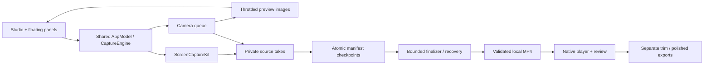

# Native architecture and gap implementation

This adapts Replica's architecture workflow to the user's existing Swift/macOS stack. See [recon](recon.md) for S/F IDs and [plan](plan.md) for milestones. There is no hosted infrastructure to operate.

## Stack and responsibility

| Layer | Choice | Reason / boundary |
| --- | --- | --- |
| UI | SwiftUI, narrow AppKit panels/player | Native controls, nonactivating floating windows, one shared model |
| Screen | ScreenCaptureKit picker/filter + SCRecordingOutput | Capture the user-selected source; exclude our own display windows |
| Camera | AVCaptureSession on one serial queue | Session ownership never enters SwiftUI; capture connection stays stable during a take |
| Preview | Gated, throttled image frames | At most 10 fps/720×450; hiding preview stops image conversion without reconfiguring capture |
| Storage | Atomic JSON manifests + local media files | Auditable, portable source checkpoints; private UUID paths; no database server |
| Rendering | AVFoundation, Core Image native compositor | Separate camera takes, trim and timed edit recipes; exports preserve originals |
| Captions | Installed on-device SpeechTranscriber, macOS 26+ | Availability checked; no download or server fallback |
| Diagnostics | Local OSLog, generated Swift Testing media, explicit acceptance flags | Device tests never run on normal launch |
| Privacy | Signed App Sandbox, no network entitlements | No uploader, webview, HTTP server, remote AI or process runner |

## Data model and constraints

`RecordingManifest` is the authoritative checkpoint: schema version, UUID, title, creation date, source description, immutable settings snapshot, status (`recording`, `interrupted`, `ready`), source durations, camera offsets, transcript, notes, clicks and visual cues. Source takes and exports are files within that recording's folder.

`CameraSegmentCheckpoint(index, offset)` aligns camera to its screen take. Transcript/notes/visual cues use media-relative seconds, not wall-clock dates. Creation dates use Foundation Date; display formatting follows the user locale. Subtitle time ranges and edit geometry reject non-finite/out-of-range values. UUIDs construct paths; titles never construct paths. Back-compatible decoding handles missing fields. Corrupt records are isolated rather than making the entire library unusable.

One recording has many finalized takes, transcript intervals, notes and edit cues. There are no accounts or cross-user database rows. Owner-only files/directories and path checks enforce local access; remote volumes, iCloud items and symlink escapes fail closed. Existing ready output is not overwritten during recovery.

## Flow and lifetime

Closing the studio does not own/stop capture: AppModel outlives windows; `FloatingRecorderController` manages panels with the same state. Screen source changes, recording settings and device preparation have one owner. The camera queue handles configure/start/finish/release; views hold only images. Main-thread publication is limited to UI state/frame delivery.

## Internal interfaces (no HTTP routes)

| Interface | Input → result | Flow / safety |
| --- | --- | --- |
| `CaptureEngine.chooseSource/start` | Validated settings + OS-selected filter → journaled session | F01; no implicit capture on launch; source absence blocks start |
| `pause/resume/stop` | Current session → finalized take / new take / ready output | F02–03; phase gating prevents concurrent transitions |
| `AppModel.toggleFloatingCamera` | Shared camera state → preview visibility | F02; never flips capture connection during recording |
| `RecordingFinalizer` | Manifest + discovered source files → validated output | F03; per-operation deadlines, explicit missing-camera fallback |
| `ExportRunner` | Local source + edit recipe → temporary then promoted file | F05; owned cancellation; no late completion promotion |
| `RecordingLibrary` | UUID and metadata → atomic local checkpoint/search/exports | F03–05; paths validated; originals retained |
| `LocalTranscriber` | Local audio + installed language → timed transcript | F04; no runtime asset installation or network fallback |
| `FloatingRecorderController` | Model/phase → panels, placement and visibility | F06; nonactivating; frame autosave and screen-bound restoration |

No webhooks, scheduled uploads, billing, email, authentication, server APIs or remote ownership checks. Processing runs only in an explicitly owned local task started by the user.

## Failure behavior and hard parts

- Deadlines must release the caller even when framework work does not cooperate. Late callbacks are one-shot and cannot resume twice or promote cancelled output. A deadline does not prove the underlying framework released a device: failed camera release blocks another start and requires restart.
- Stop/pause progress must remain visible. Cancelling retains finalized source files and refreshes the canonical checkpoint. An already committed ready MP4 is not downgraded by a racing error/cancellation.
- Pause ends a take; resume starts a take. This is not frame-perfect seamless pause. Live A/V host-clock offsets and discontinuities need drift validation.
- Display capture must exclude the app's own windows without broadening the user's chosen source. Failure to construct an exclusion filter fails closed. Window capture includes only the chosen window.
- Camera preview position and encoded composition are currently independent. Next implementation needs normalized source coordinates, a timestamped overlay recipe and explicit encoding visibility; drag must not reconfigure the capture graph.
- Exports currently re-encode camera composition and retain takes. Long recordings need measured processing/storage budgets, disk warnings and preservation through interrupted writes. No CPU/energy advantage is established.
- Device disconnect, permission revocation, sleep/lock and display removal are release gates, not inferred passing behavior.
- Distribution signing/notarization and lowest supported OS acceptance remain separate from successful local ad-hoc signing.

## Build order

The vertical slice already passes with generated content and short real camera capture. Finish reliability gates on S01–05/S08–09 before new features. Then implement encoded camera events and global/audio controls (S01–03), richer local editing (S05/S07), and verified local recognition/search (S05–06). Each stage must preserve F03 recovery and the runtime network boundary. Detailed cases are in [test-plan.md](test-plan.md).
