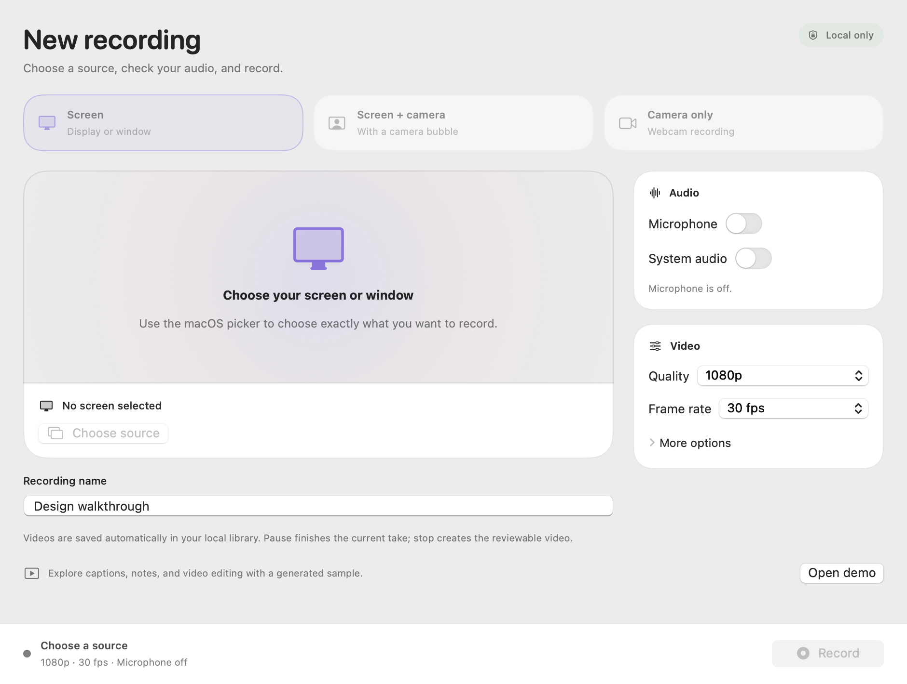
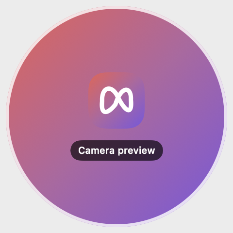

# Generated OpenLoom UI fixtures

These images were rendered from our own SwiftUI views with empty setup, a camera placeholder, or the labeled generated demo. No desktop, actual camera frame, personal transcript or library inventory is included. S02 uses a simulated recording phase, not live capture. S05 uses generated content; the offscreen renderer omits the AppKit video surface. Native glass and player rendering require interactive inspection. Original Loom screenshots are not included.

