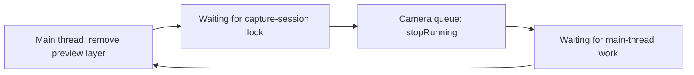
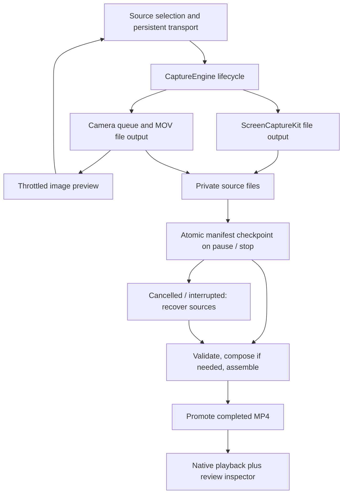

# Recording reliability review — 5 October 2026

The initial app had features before it had a proven recording lifecycle. Two failures were observed on this Mac: a camera-preview teardown deadlock, and an abort when the saved video opened in SwiftUI's `VideoPlayer`. Passing generated-media tests did not exercise either integration. The interface also hid its transport controls below a long setup page and hid the entire app when capture started.

The broader [18-project survey](loom-and-local-alternatives.md) remains the feature and license inventory. This review reads actual capture/recovery source in three relevant projects. Competitor binaries were not run; their performance and crash safety were not independently measured. Exact inspected file hashes are in [the source ledger](source-ledger.json).

## What other projects do

| Project | Source-backed behavior | What OpenLoom should learn |
| --- | --- | --- |
| Cap | Studio capture has explicit pause/resume/stop intents, producer shutdown acknowledgements, per-track errors and persisted failure metadata. Recovery validates source material before publishing recovered output. Its real-device runner checks pause scenarios, playback timing, frame drops and A/V alignment. | Separate capture, finalization, recovery and editing. Test the installed app and real devices as well as generated media. Never substitute a ready-looking UI for confirmed shutdown. |
| QuickRecorder | Pause gates incoming buffers and compensates timestamps. Stop marks writer inputs finished, checks the writer's final status and reports failure. The inspected stop path also calls `DispatchGroup.wait()`, and camera shutdown remains imperative. | Writer completion is the save boundary. Source presence alone is insufficient. Its blocking wait is not a pattern to transplant into our UI actor. |
| OpenCapture | The inspected writer uses MOV and a one-second movie-fragment interval, real-time inputs and serialized audio appends. Its cancel path deletes the partial file. The camera manager uses a preview layer and synchronous session start/stop. | Incremental writing is useful, but fragmentation alone is not an independently verified crash guarantee. Our explicit cancellation policy keeps sources, and our UI must not own a capture-session preview layer. |

Primary source links: [Cap Studio lifecycle](https://github.com/CapSoftware/Cap/blob/main/crates/recording/src/studio_recording.rs), [Cap recovery](https://github.com/CapSoftware/Cap/blob/main/crates/recording/src/recovery.rs), [Cap device runner](https://github.com/CapSoftware/Cap/blob/main/crates/recording/examples/real-device-test-runner.rs), [QuickRecorder stop/pause](https://github.com/lihaoyun6/QuickRecorder/blob/main/QuickRecorder/SCContext.swift), [QuickRecorder capture callbacks](https://github.com/lihaoyun6/QuickRecorder/blob/main/QuickRecorder/RecordEngine.swift), [OpenCapture writer](https://github.com/simarahitamtech/OpenCapture/blob/main/SimaraRecord/Sources/Core/VideoWriter.swift), [OpenCapture camera](https://github.com/simarahitamtech/OpenCapture/blob/main/SimaraRecord/Sources/Core/WebcamManager.swift).

These are architectural observations, not a recommendation to copy their implementation. OpenLoom's repair is original code under the repository's MIT license. No competitor code or dependency was imported.

## Why this app failed

### Camera stop deadlock — established by a live process sample

The main thread destroyed an `AVCaptureVideoPreviewLayer` and entered capture-session configuration. Meanwhile the camera queue was inside `AVCaptureSession.stopRunning`, waiting for main-thread work. Each waited on the other. The saved evidence is `.build/OpenLoom-hang.sample.txt`.

A timeout scheduled on the main actor cannot run when that thread is blocked. The repair removes the lock cycle: the camera session is private to its queue; an optional data-output delegate emits throttled `CGImage` frames; SwiftUI displays those images without retaining a session or preview layer.

### Playback abort — established by crash reports

The first authorized camera check finalized two takes and saved an MP4. The process then aborted while the system `_AVKit_SwiftUI` framework initialized generic metadata for `VideoPlayer`. Reopening playback reproduced the same crash site. This establishes the failing integration, not the underlying cause inside Apple's framework. The replacement mounts AppKit's `AVPlayerView` through a narrow representable. The acceptance checks verify the controller actually mounted in the review window and advance its playback clock.

### Finalization and UI gaps

Previously pause also rendered the camera overlay; stop awaited framework completion without a comprehensive deadline; there was no consistent progress/cancel path. Recovery relied too much on completed metadata, even though a finished source file could survive an interrupted metadata update. The setup UI put transport controls after large forms and explanatory sections.

## Repaired architecture

- Pause finishes and journals a source take. Camera compositing happens at stop, with progress.
- Camera MOV output uses a one-second fragment interval. Abruptly interrupted takes still require validation; recovery is not guaranteed for every incomplete file.
- Async deadlines return without joining a framework task that ignores cancellation. Late completion cannot promote an output after cancellation.
- Screen start/finish, camera start/finish/release and media metadata reads are bounded. Exports cancel after 60 seconds without advancing progress, with an additional duration-scaled overall deadline.
- Rendering writes a new temporary file. Validated output is promoted after a cancellation check. Original source takes remain.
- Recovery discovers contiguous source takes whose metadata update was interrupted. Screen-only recovery is an explicit fallback for a missing camera take.
- An unexpected successful camera finish initiates saving with a reason visible to the user. Low disk space also initiates saving with an explanation.
- The main window stays visible during capture. Its transport sits outside scrolling content and remains present while browsing the library.
- Review places playback beside transcript/notes. Trim and edit exports expose progress and cancellation inside their sheets.

## Floating controls and camera preview

Loom documents movable recording menus, a camera bubble that stays above other applications, and camera-bubble resizing. Its live camera toggle can change what appears in the recorded video. [Loom desktop redesign](https://www.loom.com/blog/redesigned-desktop-app-record-loom), [camera visibility](https://support.atlassian.com/loom/docs/make-your-camera-bubble-visible-in-loom-recordings/), [capture modes](https://support.atlassian.com/loom/docs/use-looms-different-capture-modes/).

OpenLoom 0.4 uses two native nonactivating `NSPanel` windows: a capsule recorder and a circular camera preview. They share the main app's recorder; closing the studio never creates or destroys a capture engine. The recorder provides source selection, microphone setup, preview toggle, timer, pause/resume, chapter marking and stop/save. The preview has three sizes and a saved window position. The original ribbon mark and coral/violet palette extend through the sidebar, source cards and locally generated app icon.

AppKit supplies background dragging, floating-window level and Space/fullscreen configuration. These properties have been checked inside the installed app; full physical mouse/Space coverage is listed separately in validation. [Nonactivating panels](https://developer.apple.com/documentation/appkit/nswindow/stylemask-swift.struct/nonactivatingpanel), [background dragging](https://developer.apple.com/documentation/appkit/nswindow/ismovablebywindowbackground), [fullscreen auxiliary windows](https://developer.apple.com/documentation/appkit/nswindow/collectionbehavior-swift.struct/fullscreenauxiliary).

During hardware acceptance, enabling a disabled data-output connection caused macOS to rebuild its camera graph and end the movie after 0.16668 seconds. The short movie was saved and sources retained. The local framework log traced that rebuild to `CameraRecorder.setPreviewEnabled`. The repair keeps the capture graph fixed for each take; a delegate gate controls image generation. Hiding preview does no image conversion/rendering, while the data-output connection stays available until the take finishes. Native YUV pixel formats are preferred when supported; image previews are capped at 10 fps and 720×450 pixels. This avoids treating a display toggle as a device reconfiguration. [Apple video-data output guidance](https://developer.apple.com/documentation/avfoundation/avcapturevideodataoutput), [pixel-format guidance](https://developer.apple.com/documentation/technotes/tn3121-selecting-a-pixel-format-for-an-avcapturevideodataoutput).

Display filters preserve the chosen display and exclude OpenLoom's own application, including panels created later. This requires macOS 15.2 filter-inspection APIs. Picker exclusion alone is not a recording exclusion. Real display-exclusion acceptance is still pending. [Filter included displays](https://developer.apple.com/documentation/screencapturekit/sccontentfilter/includeddisplays), [application exclusion initializer](https://developer.apple.com/documentation/screencapturekit/sccontentfilter/init(display:excludingapplications:exceptingwindows:)).

The floating preview's position/visibility is independent of the encoded camera overlay. Recorded camera position still uses presets; hiding preview continues camera recording. Live removal/repositioning of the encoded overlay and global hotkeys remain future work. This distinction is stated in the preview's help text and app documentation.

## Verification and remaining limits

Current results and exact hardware measurements are maintained in [VALIDATION.md](../macos/VALIDATION.md). Generated-content checks do not substitute for screen/audio/device-interruption or long-recording acceptance. Hardware camera checks report timings, file metadata and playback state only; footage stays in the private library and is never included in reports or research artifacts.

For a visual explanation of the Apple recording APIs, watch [WWDC24: Capture HDR content with ScreenCaptureKit](https://developer.apple.com/videos/play/wwdc2024/10088/). YouTube search terms: `Apple WWDC24 ScreenCaptureKit recording to a file` and `AVCaptureSession serial queue concurrency`.
