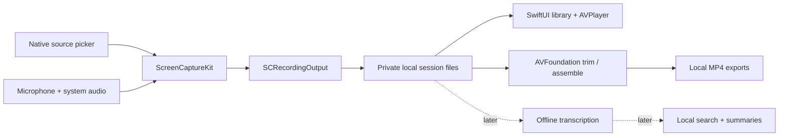

# Loom research and the OpenLoom build decision

Research date: 5 October 2026. Scope: a native macOS recorder whose application never sends recordings, audio, transcripts, metadata, or telemetry over the network.

## Recommendation

Build a small SwiftUI application around Apple's ScreenCaptureKit and AVFoundation. Use the established native recorders as engineering references and Cap as a product reference. Start with screen/window capture, microphone and system audio, pause/resume, a persistent local library, playback, and non-destructive trim/export. Then add a dedicated camera compositor, annotation/cursor tooling, and optional offline speech/AI.

The opportunity is a coherent local recording-and-editing workflow with an enforceable network boundary. Basic screen recording alone is already well served. The recommendation is an engineering judgment based on the sources below, not a measured performance comparison.

## What Loom does

| Area | Observable Loom behavior | Local implementation |
| --- | --- | --- |
| Capture | Screen + camera, screen only, camera only; display/window/custom dimensions; mic selection and system audio | ScreenCaptureKit for screen/window/audio; AVCaptureSession for a dedicated camera source |
| Recording UX | Countdown, pause/stop, camera bubble, notes, drawing, cursor/click emphasis | Native controls, menu bar, local session state, overlays |
| Editing | Trim/cut, transcript edits, filler/silence removal, text/arrows/boxes | AVFoundation compositions and a local edit-decision list |
| Knowledge | Transcripts, titles, summaries, chapters, documents, action plans | Explicitly local ASR and local text models; optional imported model files |
| Library | Stored recordings, searchable text, folders/workspaces | App-container files plus a local index; SQLite FTS later if needed |
| Sharing | Hosted watch links, embeds, access controls, comments, reactions, viewer analytics | Cannot provide remote viewers under the no-data-leaves-the-Mac requirement |
| Integrations | Jira and other remote workflows, video bug reports | Export a local Markdown/JSON bundle; sending it externally is outside this product's strict mode |

Sources: [desktop recorder](https://support.atlassian.com/loom/docs/get-started-with-the-loom-desktop-app/), [capture modes](https://support.atlassian.com/loom/docs/use-looms-different-capture-modes/), [recording tools](https://support.atlassian.com/loom/docs/choose-your-recording-mode/), [system audio](https://support.atlassian.com/loom/docs/capture-internal-audio-system-audio/), [AI and editing features](https://support.atlassian.com/loom/docs/loom-ai-features/). Availability varies by Loom plan and platform; this report does not claim every feature is present on every client.

## How Loom works: what is documented

The desktop app captures media, Loom's backend makes encoded renditions, and its web player adapts playback using HLS. Its documented Mac media profile uses H.264 video near 30 fps and AAC audio at 48 kHz; downloads are MP4. The extension uses a different browser-oriented encoding path. [Loom encoding documentation](https://support.atlassian.com/loom/docs/loom-video-encoding-settings-by-platform/).

Loom's web record SDK has a TypeScript/JavaScript entry point, UI in a shadow DOM, and a background iframe served by loom.com that mediates business logic and Loom APIs. This describes the web SDK; it is not evidence of the desktop app's internal implementation. [SDK architecture](https://dev.loom.com/docs/record-sdk/details/architecture).

Loom documents sending transcript text to OpenAI for some AI features and video/audio to Gemini for agent action plans. It also names Whisper and transcription providers. Those data flows do not satisfy this project's requirement even when a provider promises not to retain or train on the content. [Loom AI documentation](https://support.atlassian.com/loom/docs/loom-ai-features/).

Loom does not publish enough desktop implementation detail to establish its exact Mac capture pipeline, upload chunk sizes, queue design, or current CPU/RAM consumption. We should reproduce the workflow and outcomes using public platform APIs, without pretending to know undocumented internals.

## Existing projects

I searched four main territories: Loom's own product/architecture, direct Loom substitutes, native Mac capture tools, and broader recorder/editor projects. Follow-up searches checked Apple APIs and licenses. Eighteen repository identities were directly checked through GitHub. Discovery returned 55 result slots, with duplicate results; this is not a claim that 55 distinct projects were audited. The ledger records verified file URLs and blob hashes. This is a broad practical survey, not an exhaustive list of every repository on GitHub.

Features below are repository/documentation claims. I did not install, benchmark, or security-audit these competitors. “Local capable” does not mean every distribution or feature is network-isolated.

| Project | Stack / platform | What matters | Fit for strict local native macOS |
| --- | --- | --- | --- |
| [Cap](https://github.com/CapSoftware/Cap) | Rust + Tauri/Solid desktop; web services; Mac/Windows | Closest complete Loom-style product: capture, local Studio editor, sharing, comments, transcript, analytics | Excellent product reference; larger stack than needed. Instant Mode uploads during recording. Studio Mode is local capable. Root AGPLv3 with specific MIT capture/camera crate exceptions. [README](https://github.com/CapSoftware/Cap/blob/main/README.md), [license](https://github.com/CapSoftware/Cap/blob/main/LICENSE) |
| [Screenity](https://github.com/alyssaxuu/screenity) | Chromium extension | Strong annotations, blur, cursor effects, camera, editing | Local extension mode is documented; official-store Pro/Drive paths introduce network features. GPLv3. Native SwiftUI would be a rewrite. [README](https://github.com/alyssaxuu/screenity/blob/master/README.md), [license](https://github.com/alyssaxuu/screenity/blob/master/LICENSE) |
| [QuickRecorder](https://github.com/lihaoyun6/QuickRecorder) | Swift / ScreenCaptureKit; Mac | Broad native capture support, loopback audio, mouse emphasis, magnification, Presenter Overlay, HEVC alpha | Strong established native reference; lacks Loom's knowledge/library collaboration layer. AGPLv3. [Repository](https://github.com/lihaoyun6/QuickRecorder), [license](https://github.com/lihaoyun6/QuickRecorder/blob/main/LICENSE) |
| [Azayaka](https://github.com/Mnpn/Azayaka) | Swift; Mac | Compact screen/window/system-audio recorder; codec/container choices | Useful minimal capture reference. License filename was not resolved by this pass; verify before copying any source. [Repository](https://github.com/Mnpn/Azayaka) |
| [OpenCapture](https://github.com/simarahitamtech/OpenCapture) | SwiftUI/ScreenCaptureKit/AVFoundation/Vision; Mac | Local capture, pause, webcam, teleprompter, annotation; dependency-free Apple frameworks | Closest small native feature reference. README claims crash-tolerant fragmented MP4; that needs independent recovery tests. MIT. [README](https://github.com/simarahitamtech/OpenCapture/blob/main/README.md), [license](https://github.com/simarahitamtech/OpenCapture/blob/main/LICENSE) |
| [CaptureThis](https://github.com/meck93/capture-this) | SwiftUI/ScreenCaptureKit; Mac 15+ | Native picker, SCRecordingOutput, system/mic audio, Presenter Overlay, CLI | Most relevant simple capture architecture. Narrower product than a library/editor. MIT. [README](https://github.com/meck93/capture-this/blob/main/README.md), [license](https://github.com/meck93/capture-this/blob/main/LICENSE) |
| [ScreenCap](https://github.com/vertusdesign/ScreenCap) | SwiftUI/AppKit; Mac | Screenshot annotations, local native recording, recovery; declares no app-owned network fetches | Privacy/reference candidate; primarily a capture utility. MIT. Some explicit actions hand URLs to a browser, so its policy is weaker than never opening remote destinations. [README](https://github.com/vertusdesign/ScreenCap/blob/main/README.md), [license](https://github.com/vertusdesign/ScreenCap/blob/main/LICENSE) |
| [Open Loom](https://github.com/jayden9889/open-loom) | Electron; native audio helper; self-hosted sharing options | Local MP4 library, screen/camera modes, whisper.cpp option, comments/reactions/watch pages | Very relevant product checklist, but not native SwiftUI. Live README and LICENSE say AGPL-3.0; indexed search excerpts still said MIT. Trust checked files over stale excerpts. [README](https://github.com/jayden9889/open-loom/blob/main/README.md), [license](https://github.com/jayden9889/open-loom/blob/main/LICENSE) |
| [OpenScreen](https://github.com/getopenscreen/openscreen) | Desktop web UI + native capture helpers; Mac/Windows/Linux | Polished demos: zooms, cursor animation, camera sidecar, offline captions, GPU export | Strong editor reference; native capture does not make the whole UI native. MIT. The original repository is archived; use the continuation. [README](https://github.com/getopenscreen/openscreen/blob/main/README.md), [license](https://github.com/getopenscreen/openscreen/blob/main/LICENSE) |
| [Recordly](https://github.com/younghai/Recordly) | Electron orchestration with platform capture helpers | Cursor animation, motion/zoom, demos, local projects | Useful editing reference, related to the OpenScreen family rather than an independent capture architecture. MIT. Multiple forks exist; this row identifies the reviewed one. [README](https://github.com/younghai/Recordly/blob/main/README.md), [license](https://github.com/younghai/Recordly/blob/main/LICENSE) |
| [Capturia](https://github.com/MinhOmega/Capturia) | OpenScreen-derived desktop application | Demo editing, local captions, native capture and GPU export | Another useful editor reference; substantial common ancestry with OpenScreen. MIT with upstream attribution retained. [README](https://github.com/MinhOmega/Capturia/blob/main/README.md), [license](https://github.com/MinhOmega/Capturia/blob/main/LICENSE) |
| [OBS Studio](https://github.com/obsproject/obs-studio) | C/C++; cross-platform | Mature compositing, audio routing, encoding, recording, streaming | Best mature capture engine reference, but a studio interface rather than a simple Loom flow. Local recording is possible; streaming/network features exist. GPLv2 or later. [Repository](https://github.com/obsproject/obs-studio), [license](https://github.com/obsproject/obs-studio/blob/master/COPYING) |
| [Kap](https://github.com/wulkano/Kap) | Web technology / Electron; Mac | Compact recorder and export workflow | Local-capable utility, non-native UI. MIT reported by the repository's indexed metadata; exact license file was not resolved in this pass. [Repository](https://github.com/wulkano/Kap) |
| [Kooha](https://github.com/SeaDve/Kooha) | Linux desktop recorder | Simple audio/screen capture | Useful UX reference, no Mac implementation. GPLv3. [README](https://github.com/SeaDve/Kooha/blob/main/README.md), [license](https://github.com/SeaDve/Kooha/blob/main/COPYING) |
| [ScreenToGif](https://github.com/NickeManarin/ScreenToGif) | .NET / Windows | Screen/webcam recorder and frame editor | Editor ideas only for our target. Ms-PL. [README](https://github.com/NickeManarin/ScreenToGif/blob/master/README.md), [license](https://github.com/NickeManarin/ScreenToGif/blob/master/LICENSE.txt) |
| [ShareX](https://github.com/ShareX/ShareX) | C# / Windows | Capture, annotations, export/upload destinations | Useful capture UX; uploading must be removed/disabled for our policy. No direct SwiftUI foundation. GPLv3. [Repository](https://github.com/ShareX/ShareX), [license](https://github.com/ShareX/ShareX/blob/develop/LICENSE.txt) |
| [vokoscreenNG](https://github.com/vkohaupt/vokoscreenNG) | Linux/Windows | Screen/area/audio/camera and recording controls | No native Mac foundation. GPLv2 license file. [Repository](https://github.com/vkohaupt/vokoscreenNG), [license](https://github.com/vkohaupt/vokoscreenNG/blob/3.0/COPYING) |
| [Peek](https://github.com/phw/peek) | Vala / Linux | Small GIF recorder | Historical UX reference only: archived and deprecated. [Maintainer explanation](https://github.com/phw/peek/issues/1191) |

There is already another project named Open Loom. Use OpenLoom as a working name, and settle on a distinct public name before publishing. No repository or app was published during this task.

## Build versus fork

For the quickest broad native recorder, evaluate a fork of OpenCapture or QuickRecorder. That would require building them, examining failure handling, and checking all imported licenses and dependencies. Their advertised feature lists are not a substitute for those checks.

For this workspace I recommend a new small implementation: public Apple APIs, no third-party runtime dependencies, a focused local library, and a signed sandbox bundle without network entitlements. That makes the privacy contract and future editor architecture easier to control. This does not imply existing implementations are inefficient. No competitor benchmark was run.

Code written here can use MIT because it is original implementation code. Do not copy AGPL/GPL source into an MIT-only project on the assumption that open source means unrestricted relicensing. Any future source reuse needs an explicit attribution/license decision based on the actual files being imported.

## Local-only architecture

Apple's macOS 15 APIs capture screen, system audio, and microphone and write directly to a file using SCRecordingOutput. The system content picker and Presenter Overlay are available for native capture experiences. [Apple WWDC24](https://developer.apple.com/videos/play/wwdc2024/10088/), [ScreenCaptureKit](https://developer.apple.com/documentation/screencapturekit).

The initial capture foundation targeted macOS 15. Version 0.4 requires **macOS 15.2** to inspect picker filters and explicitly exclude the app's floating windows from display recording. Supporting macOS 13/14 adds a separate microphone path and manual asset writer. The native foundation does not require a Node, Python, Docker, or backend runtime.

The first implementation uses SCRecordingOutput for each uninterrupted take. Pause finalizes a segment; resume starts another segment. Final export concatenates completed segments locally. This keeps timing aligned across pause boundaries, at the cost of restart latency and possible Presenter Overlay reconfiguration. It is not frame-perfect seamless pause. Later, a carefully tested custom writer can produce fragmented MP4, separate editable tracks, and finer pause control.

## What “nothing leaves this computer” means

1. App Sandbox is enabled. Do not grant network.client or network.server entitlements. The application contains no uploader, analytics SDK, remote API, web player, updater, or localhost server. [Apple sandbox documentation](https://developer.apple.com/documentation/security/app-sandbox).
2. Recordings and metadata go into the app's Application Support container, not Desktop/Documents/iCloud. Exports are made inside that same library.
3. Only explicit recording actions may request screen/microphone access. No capture starts on launch.
4. Playback takes local file URLs only. Optional future model files must be supplied locally; the app must never silently download a model.
5. Offline AI must run inside the application or a separately sandboxed helper with network denied. Using an HTTP endpoint on localhost is insufficient: that server can send data elsewhere.
6. No Spotlight indexing, remote integrations, browser-opening actions, cloud-folder selection, external share sheet, or automatic crash reports are added to the strict build.

App isolation cannot prevent a user copying a file elsewhere or OS/third-party backup software reading the disk. The enforceable promise is that OpenLoom itself has no network access and never initiates a transfer. A whole-machine guarantee also depends on those outside services. FileVault is the existing system-level disk encryption option; app-level encryption would be a separate feature.

## Feature replication plan

| Feature | Feasibility under strict local mode | Sequence / limits |
| --- | --- | --- |
| Display/window video | Fully local | Foundation; native system picker |
| Mic + system audio | Fully local | Foundation; request mic only when enabled; test each combination |
| Cursor visibility | Fully local | Foundation toggle |
| Countdown / pause / resume / stop | Fully local | Foundation; pause uses finalized segments |
| Library / replay / rename / trim | Fully local | Foundation; preserve originals and create local exports |
| Camera bubble | Fully local | Implemented in 0.2 with AVCaptureSession sidecars and native final composition; preset corner/size controls; live-device sync still needs validation |
| Camera-only video / custom region | Fully local | Camera-only implemented in 0.2; custom-region capture remains future work |
| Drawing / arrows / notes / click halos | Fully local | 0.2 has timed post-recording edits, chapters/notes, display-click metadata, and separate MP4 exports; live drawing remains future work |
| Blur / redaction | Fully local | Vision/Core Image; irreversible render for exported redactions; verify every frame |
| Transcripts / captions / transcript edits | Fully local with installed models | 0.2 uses on-device Apple SpeechTranscriber on macOS 26+, installed assets only; search, correction, SRT/VTT. Whisper remains a portability candidate |
| Silence / filler removal | Fully local | Audio energy/VAD plus ASR timings; preview edits and preserve original |
| Titles / summaries / chapters | Fully local with installed models | llama.cpp/MLX or deterministic fallback; CPU/RAM/model-size tradeoffs; content can be wrong |
| Search across recordings | Fully local | 0.2 searches titles, transcript text, and notes; a scalable index/OCR can come later |
| Teams / remote comments / public URLs / view analytics | Incompatible with strict policy | Keep out of this product; local annotations/notes are possible |
| Jira / Slack / email posting | Incompatible with strict policy | Create local files only |
| Live remote screen streaming | Incompatible with strict policy | Keep out |

Offline speech candidates: [whisper.cpp](https://github.com/ggml-org/whisper.cpp). Offline text candidates: [llama.cpp](https://github.com/ggml-org/llama.cpp), [MLX Swift](https://github.com/ml-explore/mlx-swift). These are future integration candidates; not installed, downloaded, or included in the first app. Each selected model needs its own license and device-budget check.

For 0.2, Apple's SpeechAnalyzer/SpeechTranscriber provides an on-device pipeline without embedding a third-party runtime. The implementation checks `installedLocales` and requires an installed asset status, then analyzes locally prepared audio. It never calls the asset installation/download API and has no server-recognizer fallback. This makes captions conditional on existing OS assets and supported hardware; macOS manages those assets outside the app. [SpeechTranscriber](https://developer.apple.com/documentation/speech/speechtranscriber), [AssetInventory](https://developer.apple.com/documentation/speech/assetinventory), [Apple WWDC25](https://developer.apple.com/videos/play/wwdc2025/277/).

## Efficiency design and validation

Use 1080p/30 fps by default, a small capture queue, H.264 for broadly compatible MP4, and native pixel buffers. Stop capture work entirely while paused. Avoid an always-running preview, thumbnail generation for every frame, a browser renderer, and AI inference while recording. These are design choices, not benchmark claims. ScreenCaptureKit exposes frame interval, output dimensions, pixel format, and queue depth. [Apple WWDC22](https://developer.apple.com/videos/play/wwdc2022/10155/).

Measure on both an older supported Mac and an Apple Silicon Mac: launch/idle RAM, CPU, recording dropped frames, 30-minute audio drift, storage use, low-space behavior, and export latency. Compare equal resolution, codec, frame rate, and audio settings. Publishing “faster than Loom” requires this evidence.

The real-device validation matrix must include microphone denied/granted, system audio only, combined audio, headphones/Bluetooth/device removal, source window closing, screen locking/sleep, external display unplugging, rapid stop/pause, low disk space, export cancellation, crash interruption, and recovery from completed segments. Protected media can produce blank video or unavailable audio; do not promise capture of DRM content.

## Build checkpoints

1. Foundation: compile, sandbox/package, test session storage and segment/trim export on synthetic media, launch the native library UI. Keep capture inactive until the user chooses a source and starts.
2. Manual capture acceptance: record display/window with each audio mode, pause/resume, review MP4; test denial and interrupted sessions. This requires interactive macOS permission grants.
3. Capture polish: dedicated camera compositor, crop/region selection, microphone meters/device picker, recording HUD and global hotkeys.
4. Editor: reversible cuts, zoom keyframes, overlays, cursor event track and safe redaction.
5. Offline intelligence: user-imported models, local transcripts, subtitle exports, transcript edits, local search, optional summaries.
6. Release: stability/performance runs, accessibility, reproducible build instructions, community docs, signed/notarized distribution if authorized. Never upload recordings for validation.

Implementation update: after the foundation, the user requested explicit camera capture and all three workflow additions in this order: captions/search, chapters/notes, drawing/highlights/zoom. Those paths are implemented. Version 0.4 adds floating controls, draggable camera preview and an original visual identity. The [capture/reliability review](capture-reliability-comparison.md) records source-backed architectural changes; [validation](../macos/VALIDATION.md) separates generated/UI checks from real-device acceptance. Region capture, live drawing, continuous cursor tracks, advanced cuts/redaction, and local summaries remain later work.

## Visual learning resources

- Watch Apple's **Meet ScreenCaptureKit** (WWDC22, session 10156).
- Watch **Take ScreenCaptureKit to the next level** (WWDC22, session 10155).
- Watch **Capture HDR content with ScreenCaptureKit** (WWDC24, session 10088); the microphone and recording-to-file sections apply to this app.
- Watch **Bring advanced speech-to-text to your app with SpeechAnalyzer** (WWDC25, session 277) on Apple Developer. OpenLoom deliberately omits the demonstrated download step.
- YouTube search: **Apple Developer ScreenCaptureKit WWDC screen audio recording**, **AVFoundation AVMutableComposition non destructive video editing Swift**, **whisper cpp Metal offline transcription macOS**.

The app includes a generated local demo with sample captions and chapters so the review/editor workflow can be explored without granting capture permissions. A real recording demo should show camera source selection, menu-bar chapter marking, caption search, and an annotated MP4 export. An offline transcription demonstration still needs installed assets and a real acceptance test.

## Evidence limits

Repository metadata and named files were checked live on this research date. Search excerpts can be older than the checked source. No unpublished Loom code was inspected. No competitor binaries were run. No CPU/RAM recording benchmarks, production signing, notarization, or whole-machine network audit were completed by research alone. The implementation/validation documents distinguish what is built and tested from this roadmap.
